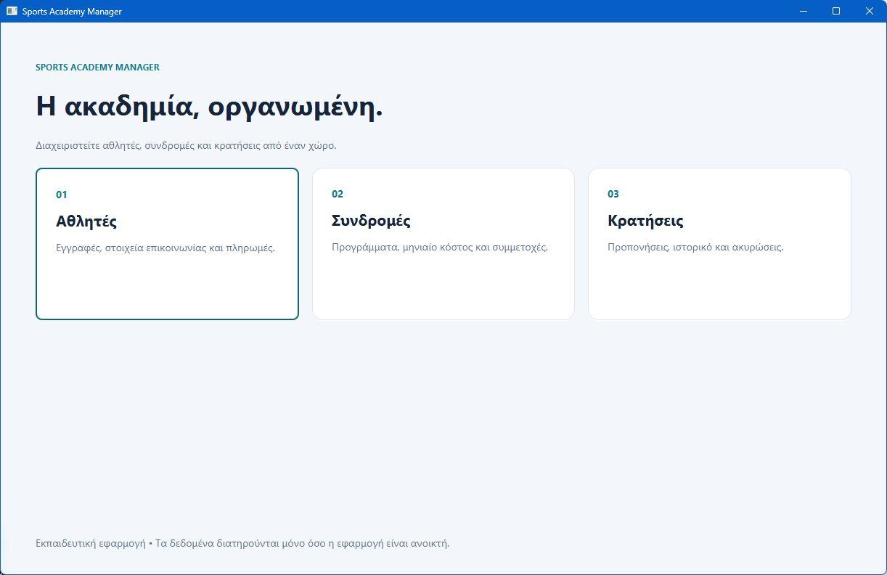

# Sports Academy Manager

A JavaFX desktop application for managing athletes, training subscriptions and reservations. Originally developed as first-year university team coursework by [FuryDSM](https://github.com/FuryDSM) and [RevolverSigma](https://github.com/RevolverSigma).

The application demonstrates object-oriented modelling, event-driven interfaces, collections, input validation and pricing rules. The interface is in Greek.



## Features

- Register athletes and update their contact and experience details.
- Record enrollment payments and calculate subscription prices from the coursework discount rules.
- Match athletes to predefined volleyball, basketball and football programs.
- Create reservations, filter by athlete, program or date, and cancel eligible reservations.
- Navigate with keyboard-accessible controls, resizable windows and scrollable forms.
- Validate calendar dates in `dd/MM/yyyy` format, including leap years.

## Run locally

Install **JDK 21** and **Maven 3.9 or later**, then run from the repository root:

```bash
mvn -f gui/pom.xml clean test
mvn -f gui/pom.xml javafx:run
```

Maven downloads the required JavaFX libraries for the current platform. Running the desktop interface requires a graphical session.

## Using the application

Start with **Αθλητές** (Athletes): enter the required details and complete the simulated enrollment payment. The displayed athlete ID is then used in **Συνδρομές** (Subscriptions) and **Κρατήσεις** (Reservations). Experience values range from 1 to 5. The predefined programs have different experience, gender and reservation requirements.

Select a table row to load its details. Buttons support keyboard activation. Dates use `dd/MM/yyyy`; reservations can be cancelled only before their scheduled calendar day.

## Project structure

| Location | Responsibility |
| --- | --- |
| `gui/src/main/java/com/example/academy/model/` | Athletes, coaches, facilities, programs, subscriptions and pricing |
| `gui/src/main/java/com/example/academy/ui/` | JavaFX screens, shared layout and calendar validation |
| `gui/src/main/resources/` | Shared visual theme |
| `gui/src/test/java/` | Calendar, pricing, eligibility and reservation-identity tests |
| `gui/pom.xml` | Reproducible dependency and build configuration |

## Scope

This is an educational application. Data is stored in memory and resets when the program closes. Payments are local demonstrations; no money is collected. Coach names and contact addresses are fictional examples. The original coursework class structure and pricing rules are retained.

The tests cover domain rules and date validation. They do not represent a complete automated test of every desktop interaction.
